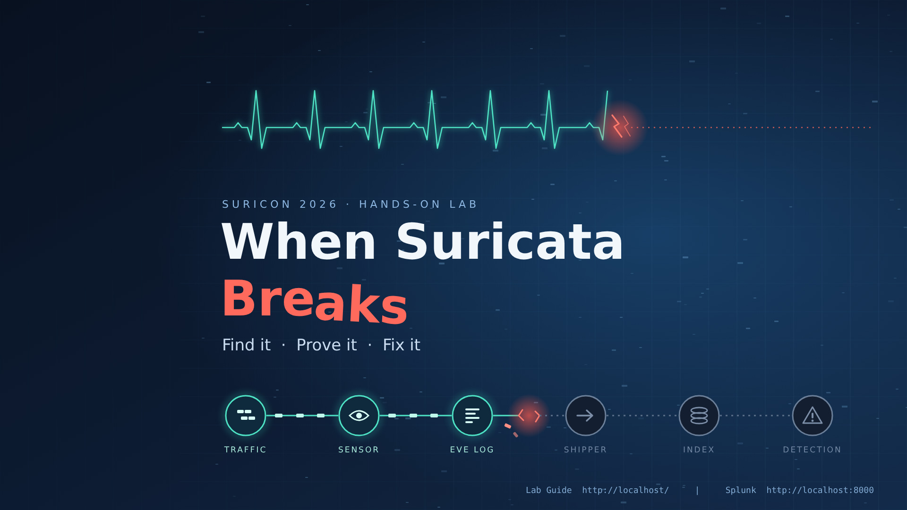

# When Suricata Breaks

### Hands-On Detection Engineering and IDS Operations Recovery Workshop



A hands-on lab for **Suricon 2026**. You get a working Suricata sensor feeding Splunk, you break it, and you bring it back, using evidence at every step.

**Find it · Prove it · Fix it**

---

## Contents

- [About the workshop](#about-the-workshop)
- [What is in the lab](#what-is-in-the-lab)
- [What you need](#what-you-need)
- [Quick start](#quick-start)
- [Importing the OVA into VMware Workstation](#importing-the-ova-into-vmware-workstation)
- [First boot](#first-boot)
- [Running the lab](#running-the-lab)
- [Troubleshooting the VM itself](#troubleshooting-the-vm-itself)
- [Repository layout](#repository-layout)
- [Acknowledgements](#acknowledgements)

---

## About the workshop

Modern security teams rely on Suricata as a critical detection engine, yet most training focuses on rule writing and traffic analysis rather than operational failure recovery. In real environments, detection failures are far more often caused by misconfiguration, broken pipelines, resource starvation, or log ingestion issues than by missing signatures.

This workshop provides a hands-on, scenario-driven approach to operating Suricata in production. Participants are given a fully functional single-server lab that runs Suricata, a traffic generator, and Splunk in a containerized environment. The system initially operates correctly, generating alerts and normal telemetry.

The lab is then intentionally damaged through a series of realistic operational failures including configuration errors, permissions issues, rule loading problems, logging pipeline failures, interface misbinding, and resource exhaustion. Attendees must use Suricata logs, configuration validation, packet capture, and Splunk visibility to diagnose, troubleshoot, and restore the system to a healthy state.

By the end of the workshop, participants will understand:

- How to validate Suricata health beyond "the service is running"
- How to interpret Suricata startup and runtime errors
- How to troubleshoot rule loading failures and detection blind spots
- How to verify log pipelines into Splunk or other SIEMs
- How to build repeatable health checks for production sensors

This workshop is designed for security engineers, detection engineers, SOC architects, and operators who run Suricata in real environments and want deeper operational mastery of their detection infrastructure.

## What is in the lab

Everything runs inside one Ubuntu virtual machine. No internet access is needed once the VM is imported.

```
Lab traffic  ->  Suricata  ->  eve.json  ->  Fluent Bit  ->  Splunk HEC  ->  Splunk detection
```

| Component | Role |
|---|---|
| Suricata 8.0.8 | IDS sensor, captures on the lab interface and applies two lab rules |
| Lab traffic | A small packet capture replayed onto the lab interface every five minutes |
| Fluent Bit | Ships each Suricata event to Splunk over the HTTP Event Collector |
| Splunk Enterprise | Indexes the events; a scheduled alert fires when a lab rule triggers |
| Student Lab Guide | Served from the VM at `http://localhost/` |

A failure can sit at any link in that chain. Each round, one thing is broken and nothing tells you what.

## What you need

| | Minimum |
|---|---|
| Hypervisor | VMware Workstation Pro or Player 17. The lab was built and tested on Workstation 17 Pro. Other hypervisors have not been tested. |
| CPU | 64-bit with virtualization (Intel VT-x or AMD-V) enabled in firmware; 4 cores available for the VM |
| Memory | 8 GB for the VM, so 16 GB on the host is recommended |
| Disk | About 18 GB for the download, plus about 45 GB free for the imported VM |
| Time | Download the OVA **before** the conference. It is too large for conference Wi-Fi. |

## Quick start

1. **Download the VM.** The OVA is about 18 GB, which is too large to store in this repository, so it is hosted on Google Drive:

   **[Download SuriLab-2026-v11.ova from Google Drive](https://drive.google.com/drive/folders/1aXaD3xSulFdlWWydzZlk-tFz_p4RUStf?usp=sharing)**

   Open the `ova` folder and download `SuriLab-2026-v11.ova`. Google Drive will say it cannot scan the file for viruses because of its size. Choose **Download anyway**.

2. **Verify the download.** An 18 GB download can be cut short or corrupted without any warning. Compute the file's SHA-256 hash and compare it with the expected value.

   Windows (Command Prompt or PowerShell):

   ```
   certutil -hashfile SuriLab-2026-v11.ova SHA256
   ```

   macOS or Linux:

   ```
   shasum -a 256 SuriLab-2026-v11.ova
   ```

   Expected SHA-256:

   ```
   95d775954b89c96c50dd5cc780e0d0bfe3a1e745ad5f918d122d8c2a07ab258e
   ```

   If your result is different, the download is incomplete or damaged. Download it again before importing.

3. **Get the lab guide.** Download [`SuriLab-2026_Student-Lab-Guide.docx`](SuriLab-2026_Student-Lab-Guide.docx) from the root of this repository. It is the document you work from. The same guide is also built into the VM.

4. **Import the OVA** into VMware Workstation. See [the steps below](#importing-the-ova-into-vmware-workstation).

5. **Power on, log in, and wait five minutes** for Splunk to finish starting.

6. **Open the Lab Guide** from the desktop icon and begin with Exercise 1.

## Importing the OVA into VMware Workstation

1. Open VMware Workstation.
2. Choose **File → Open**, browse to `SuriLab-2026-v11.ova`, and select **Open**.
3. Give the virtual machine a name and choose a storage location with at least 45 GB free.
4. Select **Import**. This takes several minutes.
5. If VMware reports that the file did not pass OVF specification conformance checks, select **Retry**. The import then proceeds with relaxed checks.
6. Before powering on, open **VM → Settings** and confirm:
   - **Memory:** 8 GB
   - **Processors:** 4
   - **Network Adapter:** Host-only
7. Select **Power on this virtual machine**.

If you are prompted about whether the VM was moved or copied, choose **I Copied It**.

## First boot

| | |
|---|---|
| VM login | `analyst` / `analyst` |
| Splunk Web | `http://localhost:8000` with `admin` / `SuriLab2025!` |
| Lab Guide | `http://localhost/` or the **Lab Guide** desktop icon |

The lab containers start by themselves. Splunk needs about five minutes after power-on before it is ready.

To confirm the lab is healthy, open a terminal and run:

```bash
/opt/surilab/scripts/validate-health.sh
```

A healthy lab ends with `Results: 9 passed, 0 failed`. If checks fail in the first few minutes, wait and run it again.

These credentials are for an isolated training VM only. Do not reuse them anywhere else, and do not connect the VM to a production network.

## Running the lab

The [Student Lab Guide](SuriLab-2026_Student-Lab-Guide.docx) walks you through everything. In outline:

1. **Learn what healthy looks like.** Run the health check, walk the data path by hand, and look at the events and the triggered alert in Splunk.
2. **Break it.** Double-click **Break the Lab** on the desktop. The lab is reset, then one thing is quietly broken.
3. **Troubleshoot** in data-path order, and record your evidence on the worksheet in the guide.
4. **Repair and validate.** You are done when the health check shows 0 failed, fresh alerts reach Splunk, and the Splunk detection fires again.
5. **Go again.** Each click of **Break the Lab** gives a different fault. There are five.

This is an exercise, not a test, and it runs on the honor system. The **Reset the Lab** icon gives you a clean start. It is not a fix.

## Troubleshooting the VM itself

| Problem | What to do |
|---|---|
| VM will not power on, or reports that virtualization is unavailable | Enable Intel VT-x or AMD-V in your computer's firmware settings. On Windows hosts, Hyper-V and related features can also interfere. |
| Health check fails right after power-on | Splunk is still starting. Wait five minutes and run it again. |
| A desktop icon opens as a text file, or asks about launching | Right-click the icon and choose **Allow Launching**. |
| The import fails or the VM will not boot | Verify the SHA-256 hash of the download (quick start, step 2). A damaged download is the usual cause. |
| The VM is very slow | Confirm it has 8 GB of memory and 4 processors, and close other heavy applications on the host. |
| Splunk shows no new events when the lab is healthy | Replay traffic by hand: `sudo tcpreplay --intf1=ens34 /opt/surilab/pcaps/lab-traffic.pcap` |
| The lab is in a state you cannot recover | Double-click **Reset the Lab**, wait five minutes, then run the health check. |
| Google Drive refuses the download | Drive limits how often a large file can be downloaded in a short period. Try again later. |

## Repository layout

```
When-Suricata-Breaks/
├── README.md                              This file
├── SuriLab-2026_Student-Lab-Guide.docx    The student lab guide
├── docs/
│   └── SuriLab-2026_Desktop-Wallpaper.jpg Lab artwork, also the VM desktop background
└── ova/                                   Not stored on GitHub. Download the OVA from Google Drive.
```

## Acknowledgements

Suricata is developed by the Open Information Security Foundation (OISF). Splunk, VMware, Fluent Bit, Docker, and Ubuntu are trademarks of their respective owners. This workshop is an independent training exercise that uses those products.
